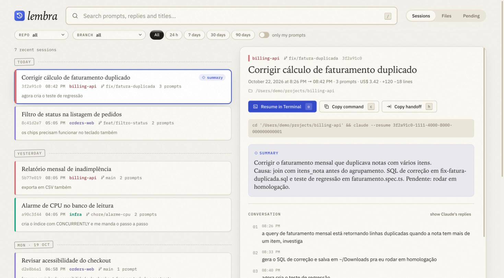
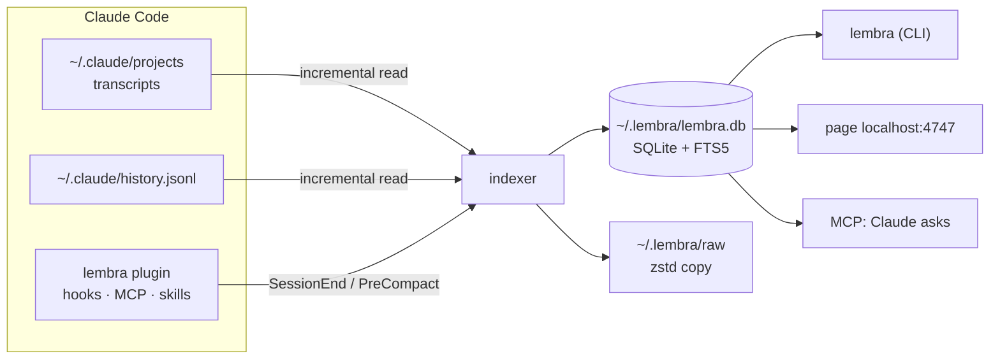

<div align="center">

# 🧠 lembra

**Permanent, searchable history for Claude Code.**

Find any session by repository, branch, date or keyword.<br/>
Recover files Claude created and you deleted. Pick the work up where it stopped.

[](.github/workflows/ci.yml)
[](https://bun.sh)
[](tsconfig.json)
[](docs/architecture.md)
[](LICENSE)


[Português](README.md) · **English**



</div>

---

*"lembra" is Portuguese for "remember".*

## The pain

If you use Claude Code all day, you know this:

- **Many terminals, no memory.** You know you solved it before, but not in which session or repository.
- **`/resume` relies on you remembering.** Running `/rename` on every session is the kind of thing nobody keeps up.
- **Claude Code deletes your history.** Transcripts older than 30 days are removed by default (`cleanupPeriodDays`).
- **Files vanish.** Claude writes a `.sql` to `~/Downloads` or a temp folder, you clean it up, and weeks later you need it again.
- **Context gets lost.** After a `/compact`, or in a new terminal, you end up prompting Claude to dig up what you two already did.
- **"Have I done something like this before?"** A proposal, a script, an analysis from two months ago. Without search, it is rework.

## Where it came from

lembra started as a six-minute voice memo describing those pains, transcribed and turned into a project together with Claude Code itself. The first look at the machine's real data confirmed all of it:

- everything older than 30 days had already been deleted by Claude Code;
- **58 of the 70 `.sql` files** Claude had created no longer existed on disk, yet their content was intact inside the transcripts;
- `~/.claude/history.jsonl` held seven months of typed prompts, far beyond the transcripts.

The first index read 2.4 GB in **14 seconds** and made **1,291 sessions** searchable, 1,145 of them rescued from the prompt history alone. It also left **837 deleted files** ready to restore. Each search takes **about 50 ms**.

## What it does

| Pain | lembra |
|---|---|
| Find an old session | Full-text search over prompts, replies, summaries and titles, ignoring accents and case, filtered by repo, branch and period. Works in the terminal, on the page and through Claude itself |
| Unnamed sessions | Uses Claude Code's automatic title (or your `/rename`) and, optionally, a summary written by Haiku |
| History deleted after 30 days | Keeps everything forever in `~/.lembra`, with a compressed copy of every transcript, and imports old prompts from `history.jsonl` |
| Deleted files | Stores the full content of what Claude wrote, edited or read outside the repo, plus files named in your prompts. One click (or `lembra restore`) puts the file back |
| Picking work back up | **Resume in Terminal** (or `lembra resume`) and the **handoff**: a brief to continue in a new session, also available as `/lembra:handoff` inside Claude |
| "Did I do this before?" | Claude searches your history on its own, through the plugin's MCP server |
| Forgotten work | `lembra pending` lists branches with recent sessions that were never pushed, have unpushed commits or uncommitted changes, or have no PR |

## Installation

**Requirements:** [Bun](https://bun.sh) 1.3 or newer, macOS (Linux works without the background services) and Claude Code.

```bash
git clone git@github.com:victorreinor/lembra.git ~/projects/lembra
cd ~/projects/lembra && bun install
bun src/cli/index.ts install        # from then on, just "lembra"
```

`lembra install` sets everything up, and you can run it again any time (`--dry-run` shows the plan first):

1. creates the `lembra` command in `~/.local/bin`;
2. raises Claude Code's retention to 3,650 days (backing up `settings.json`);
3. installs the `lembra@lembra` plugin: the MCP server, hooks that index when a session ends and before `/compact`, and the `/lembra:handoff` and history skills;
4. on macOS, registers with `launchd` the page at `localhost:4747`, started at login, and a daily index;
5. runs the first index.

To undo it: `lembra uninstall`. Your data in `~/.lembra` stays where it is.

## Usage

**On the page:** open http://localhost:4747 (or run `lembra ui`). Use "Install app" in Chrome or "Add to Dock" in Safari to turn it into an app with its own icon.

| Key | Action |
|---|---|
| `/` | search |
| `↓` `↑` or `j` `k` | browse results |
| `o` | resume in Terminal |
| `c` / `h` | copy the resume command / the handoff |
| `1` `2` `3` | sessions, files, pending |
| `?` | every shortcut |

**Inside Claude Code:** ask "have I done something like X before?" or "where is that SQL from last week?", and Claude searches on its own. To continue another session here, use `/lembra:handoff 3f2a`.

**In the terminal:**

```bash
lembra billing                           # search (words match as prefixes: "bill" finds "billing")
lembra "monthly report" --prompts        # exact phrase, only in your prompts
lembra queue sqs --repo api --since 2w
lembra show 3f2a                         # summary, prompts, files and the resume command
lembra resume 3f2a                       # reopen the session in Claude Code, in the right folder
lembra handoff 3f2a --copy               # brief to paste into a new session
lembra files .sql --missing              # files gone from disk
lembra restore 3357 --to ~/Desktop       # put a stored version back on disk
lembra pending                           # undelivered work from the last two weeks
lembra summarize                         # summarize new sessions with Haiku, on your login
lembra stats                             # vault size and retention
```

Run `lembra --help` for every command and option.

## Languages

lembra speaks **English** and **Brazilian Portuguese**. That covers the terminal, the page, error messages, handoffs, summaries and MCP results.

- **CLI, MCP and hooks:** the language comes from `--lang`; otherwise from `LEMBRA_LANG`; then from the preference stored with `lembra lang en` (or `pt-BR`, or `auto`); finally from the system language (`LANG`).
- **The page:** uses the language picked with the **EN/PT** switch in the footer. With no pick, it uses the `lembra lang` preference and, failing that, the browser's language.
- **Text meant for the model** (MCP tool descriptions, skills) stays in English, and Claude answers in the user's language.

To add a language, see [docs/i18n.md](docs/i18n.md).

## How it works



1. **Incremental reading.** Each Claude Code file is read from the byte where the previous run stopped, in 8 MB chunks. Hooks, the page and the CLI trigger it, and a line still being written waits for the next run.
2. **What becomes searchable text:** your prompts (including those sent while Claude was working), replies, `/compact` summaries and Haiku summaries. Internal commands, notifications and subagent chatter are left out.
3. **What goes into the file vault:**
   - **Write:** the full content.
   - **Edit:** the whole file, rebuilt.
   - **Read** of files outside the repo.
   - Files named in prompts.
   - Pasted images.

   Storage is content-addressed by SHA-256, zstd-compressed and deduplicated.
4. **Old sessions.** Prompts from `history.jsonl` whose transcript was already gone become `[prompts only]` sessions.
5. **Raw copy.** Every transcript is copied and compressed into `~/.lembra/raw`, so `resume` can reopen a session Claude Code deleted.

More in [docs/architecture.md](docs/architecture.md). Claude Code's file format is documented in [docs/claude-code-data.md](docs/claude-code-data.md).

## Your data

- **Everything stays local.** The index lives in `~/.lembra` (mode `700`). The page only listens on `127.0.0.1`, refuses other hosts and requires its own header for any write. Nothing is sent over the network; summaries use your own `claude -p`, only when you run `lembra summarize`.
- **The vault holds everything you ever pasted into a prompt**, including tokens and customer data. Do not sync `~/.lembra` to cloud services.
- **To start over:** `rm -rf ~/.lembra && lembra index`. The database can be fully rebuilt.

## Roadmap

| Phase | Status | Delivered |
|---|---|---|
| 0 | ✅ | Stop the loss: retention and backup |
| 1 | ✅ | Indexer, search, file vault and CLI |
| 2 | ✅ | Local page, automatic capture via hooks, `launchd` and `lembra install` |
| 3 | ✅ | MCP so Claude can search the history, `/lembra:handoff`, Haiku summaries and pending work |
| 4 | 💡 | Weekly report, secret masking, semantic search, Raycast. See [ROADMAP.md](ROADMAP.md) |

## Development

```bash
bun install
bun test              # unit, integration and component tests (happy-dom)
bun run typecheck     # strict TypeScript
bun run demo          # the page with fictional data at localhost:4848
bun src/cli/index.ts  # the CLI without installing
```

```text
src/core/     rules and data: parser, indexer, search, vault, handoff, summaries, pending work
src/i18n/     text catalogs (en, pt-BR) and language resolution
src/cli/      terminal commands
src/web/      local API and the page (components, CSS tokens)
src/mcp/      MCP server over stdio
src/system/   OS integration: launchd, Terminal, clipboard
plugin/       Claude Code plugin (hooks, .mcp.json, skills)
test/         unit · integration · web
```

Working on the project with an AI agent? Start at [CLAUDE.md](CLAUDE.md), which has the code map, the rules and what to read for each kind of task. The interface follows the [UI guide](docs/ui-guidelines.md). Project docs are written in Portuguese; code and comments are in English.

## FAQ

**Does it work with sessions from before installing it?**
Yes. Everything still in `~/.claude` comes in with full content. Sessions whose transcript was already deleted come back with the prompts kept in `history.jsonl`.

**Does lembra change anything in Claude Code?**
Only what `install` announces: retention, the plugin and the PATH link. Otherwise it only reads `~/.claude`. The one other write is when `resume` puts back a transcript Claude Code itself deleted.

**What if Claude Code changes its file format?**
The parser is covered by tests using records in the real format, verified on Claude Code 2.1.309. When the parser evolves, `PARSER_VERSION` makes lembra reprocess everything without duplicating anything.

**Why not a browser extension?**
An extension cannot read `~/.claude`. A CLI with a local page is simpler, faster and more private.

## License

[MIT](LICENSE) © Victor Reinor
