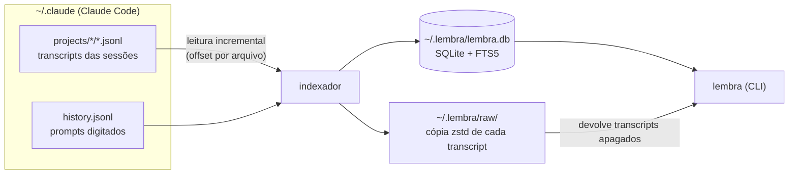

<div align="center">

# 🧠 lembra

**O histórico permanente e pesquisável do Claude Code.**

Ache qualquer prompt por repositório, branch, data ou palavra-chave.<br/>
Recupere arquivos que o Claude criou e você apagou. Retome sessões na pasta certa.

[](.github/workflows/ci.yml)
[](https://bun.sh)
[](tsconfig.json)
[](docs/architecture.md)


</div>

```text
$ lembra faturamento --since 7d
3f2a91c0  14/10/26 10:31  billing-api · fix/fatura-duplicada  Corrigir cálculo de faturamento
   › 14/10/26 10:02  …a query de [faturamento] retorna linhas duplicadas quando a nota tem…
   ‹ 14/10/26 10:05  …o join com itens multiplica o [faturamento]; agrupe antes de somar…

$ lembra files .sql --missing
#3357   22/10/26 09:42  write  billing-api      ~/Downloads/fix-fatura.sql  apagado do disco

$ lembra restore 3357
Restaurado ~/Downloads/fix-fatura.sql (1,2 KB, versão de 22/10/26 09:42)
```

---

## A dor

Quem usa o Claude Code o dia inteiro conhece isso:

- **Vários terminais, nenhuma memória.** Você sabe que já resolveu aquilo, mas não lembra em qual sessão nem em qual repo.
- **O `/resume` depende de você lembrar.** Dar `/rename` em toda sessão é o tipo de coisa que a gente esquece.
- **O Claude Code apaga o histórico.** Transcripts com mais de 30 dias são removidos por padrão (`cleanupPeriodDays`).
- **Arquivos somem.** O Claude gera um `.sql` em `~/Downloads` ou numa pasta temporária, você limpa a pasta e, semanas depois, precisa dele de novo.
- **O contexto se perde.** Depois de um `/compact` ou num terminal novo, você acaba dando "prompt do prompt" para o Claude investigar o que vocês já tinham feito.
- **"Eu já fiz algo parecido?"** Uma proposta, um script, uma análise feita há dois meses. Sem busca, isso vira retrabalho.

## Como surgiu

O `lembra` nasceu de um áudio de seis minutos descrevendo essas dores, transcrito e transformado em projeto junto com o próprio Claude Code. A primeira análise dos dados reais da máquina confirmou tudo:

- tudo que tinha mais de 30 dias já tinha sido apagado pelo Claude Code;
- **58 dos 70 arquivos `.sql`** criados pelo Claude não existiam mais no disco, mas o conteúdo continuava intacto dentro dos transcripts;
- o `~/.claude/history.jsonl` guardava os prompts digitados nos últimos 7 meses, bem além dos transcripts.

A primeira indexação levou **14 segundos** para ler 2,4 GB e deixou pesquisáveis **1.291 sessões**, das quais 1.145 foram resgatadas só pelo histórico de prompts. Ela também deixou **837 arquivos apagados** prontos para restaurar. Cada busca leva **cerca de 50 ms**.

## O que ele resolve

| Dor | O que o `lembra` faz |
|---|---|
| Achar uma sessão antiga | Busca full-text em prompts, respostas, resumos do `/compact` e títulos, ignorando acentos e maiúsculas, com filtro por repo, branch e data |
| Sessão sem nome | Usa o título automático que o Claude Code gera para toda sessão, e o nome do `/rename` quando existir |
| Histórico apagado após 30 dias | Guarda tudo para sempre em `~/.lembra`, incluindo uma cópia comprimida de cada transcript, e importa os prompts antigos do `history.jsonl` |
| Arquivo apagado | Guarda o conteúdo completo de tudo que o Claude escreveu, editou ou leu fora do repo, e dos arquivos citados nos seus prompts |
| Retomar o trabalho | `lembra resume 3f2a` entra na pasta certa e roda `claude --resume`. Se o Claude Code tiver apagado o transcript, o `lembra` o devolve antes |

## Instalação

**Requisitos:** [Bun](https://bun.sh) 1.3 ou mais recente, macOS ou Linux e Claude Code.

```bash
git clone git@github.com:victorreinor/lembra.git ~/projects/lembra
cd ~/projects/lembra
bun install
ln -s "$PWD/src/cli/index.ts" ~/.local/bin/lembra   # qualquer pasta que esteja no seu PATH
lembra index                                        # primeira indexação (alguns segundos)
```

**Recomendado:** desligue a limpeza automática do Claude Code adicionando ao `~/.claude/settings.json`:

```json
{ "cleanupPeriodDays": 3650 }
```

O `lembra stats` avisa se a retenção ainda estiver no padrão de 30 dias.

## Uso rápido

```bash
lembra                                   # sessões mais recentes
lembra faturamento                       # busca (palavras viram prefixos: "fatur" acha "faturamento")
lembra "relatório mensal" --prompts      # frase exata, só nos seus prompts
lembra fila sqs --repo billing --since 2w
lembra show 3f2a                         # prompts, arquivos e o comando para retomar
lembra resume 3f2a                       # abre a sessão no Claude Code, na pasta certa
lembra files .sql --missing              # arquivos que sumiram do disco
lembra restore 3357 --to ~/Desktop       # restaura uma versão do cofre
lembra cat 3357 | pbcopy                 # copia o conteúdo sem restaurar
lembra stats                             # tamanho do cofre e retenção do Claude Code
```

Todo comando atualiza o índice antes de rodar, o que normalmente leva milissegundos. Por isso o que você acabou de fazer em outro terminal já aparece.

## Comandos

| Comando | O que faz |
|---|---|
| `lembra [termos]` | Sem termos, lista as sessões recentes. Com termos, faz uma busca |
| `lembra search <termos>` | Busca em prompts, respostas, resumos do `/compact` e títulos, ranqueada por relevância |
| `lembra list` | Sessões por data, da mais recente para a mais antiga |
| `lembra show <sessão>` | Título, repo, branch, custo, todos os prompts, arquivos tocados e o comando para retomar |
| `lembra resume <sessão>` | Roda `claude --resume` na pasta da sessão, restaurando o transcript se ele tiver sido apagado |
| `lembra files [trecho]` | Arquivos que o Claude criou, editou ou leu, com a versão mais recente de cada um |
| `lembra restore <arquivo>` | Escreve a versão guardada de volta no caminho original, ou em `--to` |
| `lembra cat <arquivo>` | Imprime o conteúdo guardado no stdout |
| `lembra index` | Indexa e arquiva tudo. É incremental, então pode rodar sempre |
| `lembra stats` | Números do cofre, espaço usado e retenção do Claude Code |

`<sessão>` é o começo do id (`3f2a`) ou o nome dado com `/rename`.<br/>
`<arquivo>` é o `#id` mostrado em `files` e `show`, ou o caminho original do arquivo.

### Opções

| Opção | Onde vale | Efeito |
|---|---|---|
| `-r, --repo <nome>` | search, list, files | Filtra por trecho do nome do repositório |
| `-b, --branch <nome>` | search, list | Filtra por trecho do nome da branch |
| `--since <data>` / `--until <data>` | search, list, files | Intervalo de datas. Aceita `2026-10-01`, `01/10`, `01/10/2026`, `7d`, `2w`, `3m` e `1y`, e o `--until` inclui o dia |
| `-p, --prompts` | search | Busca só nos seus prompts |
| `--missing` | files | Mostra só os arquivos que não existem mais no disco |
| `-n, --limit <n>` | search, list, files | Quantidade de resultados |
| `--full` | show | Mostra os prompts completos, sem cortar |
| `--to <caminho>` / `-f, --force` | restore | Escolhe o destino (arquivo ou pasta) ou sobrescreve o arquivo existente |
| `--print` | resume | Só mostra o comando, sem abrir |

## Como funciona



1. **Leitura incremental.** Cada arquivo do Claude Code é lido a partir do byte onde a última execução parou. Uma linha ainda sendo escrita fica para a próxima execução.
2. **O que vira texto pesquisável:**
   - seus prompts, inclusive os enviados enquanto o Claude trabalhava;
   - as respostas do Claude;
   - os resumos gerados pelo `/compact`.

   O índice ignora comandos internos, notificações e conversas de subagentes.
3. **O que vira arquivo no cofre:**
   - **Write:** o conteúdo completo do arquivo.
   - **Edit:** o arquivo inteiro reconstruído, a partir do original que o Claude Code registra ou da última versão conhecida.
   - **Read** de arquivos fora do repo (Downloads, /tmp…).
   - Arquivos citados nos seus prompts.
   - Imagens coladas.

   O armazenamento é por hash SHA-256, comprimido com zstd e sem duplicatas.
4. **Sessões antigas.** Prompts do `history.jsonl` cujo transcript já foi apagado viram sessões marcadas como `[só prompts]`.
5. **Cópia bruta.** `lembra index` mantém uma cópia comprimida de cada transcript em `~/.lembra/raw`, que é o que permite ao `resume` reabrir sessões que o Claude Code apagou.

Detalhes em [docs/architecture.md](docs/architecture.md). O formato dos arquivos do Claude Code está documentado em [docs/claude-code-data.md](docs/claude-code-data.md).

## Seus dados

- **Tudo é local.** O índice fica em `~/.lembra`, com permissão `700` (só o seu usuário acessa). Nada é enviado para a rede.
- **O cofre contém tudo que você já colou num prompt**, inclusive tokens e dados de clientes. Não sincronize `~/.lembra` com serviços de nuvem.
- **Para recomeçar do zero:** `rm -rf ~/.lembra && lembra index`. O banco é totalmente reconstruível a partir de `~/.claude` e da cópia bruta.
- **Variáveis de ambiente:** `LEMBRA_HOME` muda a pasta de dados e `CLAUDE_CONFIG_DIR` aponta para outro `~/.claude`.

## Roadmap

| Fase | Status | Entrega |
|---|---|---|
| 0 | ✅ | Parar a perda de histórico: retenção e backup |
| 1 | ✅ | Indexador, busca, cofre de arquivos e CLI |
| 2 | 🚧 | Interface web local (`lembra ui`), captura automática por hooks e `launchd` |
| 3 | 💡 | Servidor MCP para o próprio Claude consultar o histórico, `/handoff`, resumos com Haiku e alertas de trabalho inacabado |

Detalhes, ideias e limitações conhecidas estão em [ROADMAP.md](ROADMAP.md).

## Desenvolvimento

```bash
bun install
bun test              # testes unitários e de integração
bun run typecheck     # TypeScript strict
bun src/cli/index.ts  # roda a CLI sem instalar
```

```text
src/core/   regras e dados: parser, indexador, busca, cofre (sem saída de terminal)
src/cli/    argumentos, formatação e comandos (Io injetável, testável)
test/unit/         funções puras
test/integration/  indexador, busca e CLI sobre um ~/.claude falso
docs/              arquitetura, formato do Claude Code e guia de UI
```

Vai trabalhar no projeto com um agente de IA? O [CLAUDE.md](CLAUDE.md) é o ponto de entrada: mapa do código, regras e o que ler para cada tipo de tarefa.

## FAQ

**Funciona com sessões de antes da instalação?**
Sim. Tudo que ainda está em `~/.claude` é indexado com conteúdo completo. Sessões cujo transcript já foi apagado voltam com os prompts que estavam no `history.jsonl`.

**O `lembra` altera alguma coisa no Claude Code?**
Não. Ele só lê `~/.claude`. A única escrita é quando o `resume` devolve um transcript que o próprio Claude Code apagou.

**E se o Claude Code mudar o formato dos arquivos?**
O parser é coberto por testes com registros no formato real, verificado no Claude Code 2.1.309. Quando o parser evolui, a constante `PARSER_VERSION` faz o `lembra` reprocessar tudo sem duplicar nada.

**Por que não uma extensão do Chrome?**
Uma extensão de navegador não consegue ler `~/.claude`. Uma CLI local é mais simples e rápida, e a interface web da Fase 2 reaproveita o mesmo núcleo.
