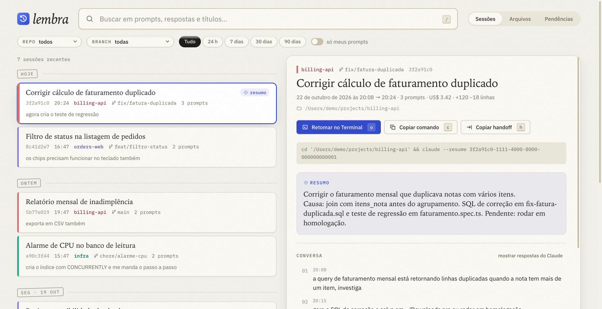
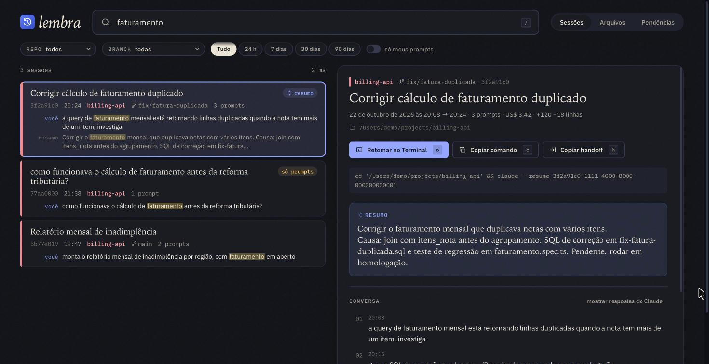
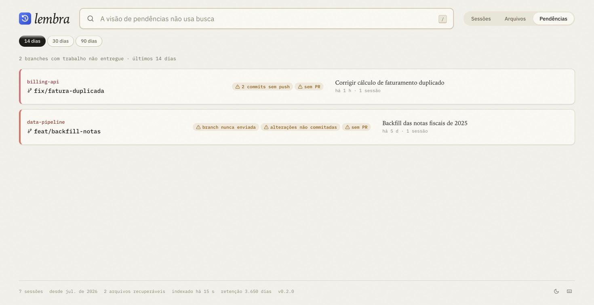
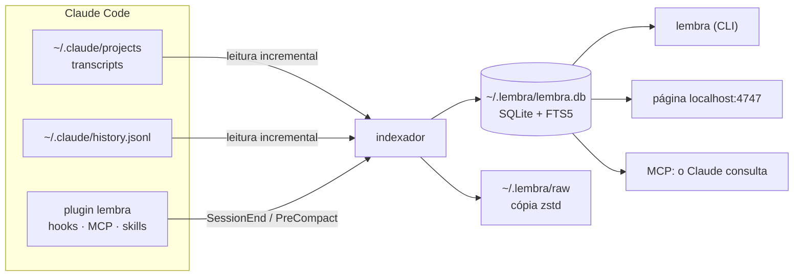

<div align="center">

# 🧠 lembra

**O histórico permanente e pesquisável do Claude Code.**

Ache qualquer sessão por repositório, branch, data ou palavra-chave.<br/>
Recupere arquivos que o Claude criou e você apagou. Retome o trabalho de onde parou.

[](.github/workflows/ci.yml)
[](https://bun.sh)
[](tsconfig.json)
[](docs/architecture.md)
[](LICENSE)


**Português** · [English](README.en.md)



</div>

---

## A dor

Quem usa o Claude Code o dia inteiro conhece isso:

- **Vários terminais, nenhuma memória.** Você sabe que já resolveu aquilo, mas não lembra em qual sessão nem em qual repo.
- **O `/resume` depende de você lembrar.** Dar `/rename` em toda sessão é o tipo de coisa que a gente esquece.
- **O Claude Code apaga o histórico.** Por padrão, transcripts com mais de 30 dias são removidos (`cleanupPeriodDays`).
- **Arquivos somem.** O Claude gera um `.sql` em `~/Downloads` ou numa pasta temporária, você limpa a pasta e, semanas depois, precisa dele de novo.
- **O contexto se perde.** Depois de um `/compact`, ou num terminal novo, você acaba dando "prompt do prompt" para o Claude investigar o que vocês já tinham feito.
- **"Eu já fiz algo parecido?"** Uma proposta, um script, uma análise de dois meses atrás. Sem busca, vira retrabalho.

## Como surgiu

O `lembra` nasceu de um áudio de seis minutos descrevendo essas dores, transcrito e transformado em projeto junto com o próprio Claude Code. A primeira análise dos dados reais da máquina confirmou tudo:

- o que tinha mais de 30 dias já tinha sido apagado pelo Claude Code;
- **58 dos 70 arquivos `.sql`** criados pelo Claude não existiam mais no disco, mas o conteúdo continuava intacto dentro dos transcripts;
- o `~/.claude/history.jsonl` guardava os prompts dos últimos 7 meses, bem além dos transcripts.

A primeira indexação levou **14 segundos** para 2,4 GB e deixou pesquisáveis **1.291 sessões**, das quais 1.145 foram resgatadas só pelo histórico de prompts. Também deixou **837 arquivos apagados** prontos para restaurar. Cada busca leva **cerca de 50 ms**.

## O que ele faz

| Dor | O `lembra` |
|---|---|
| Achar uma sessão antiga | Busca full-text em prompts, respostas, resumos e títulos, sem diferenciar acentos e maiúsculas, com filtro por repo, branch e período. Funciona no terminal, na página e pelo próprio Claude |
| Sessão sem nome | Usa o título automático do Claude Code (ou o seu `/rename`) e, opcionalmente, um resumo gerado com Haiku |
| Histórico apagado após 30 dias | Guarda tudo para sempre em `~/.lembra`, com uma cópia comprimida de cada transcript, e importa os prompts antigos do `history.jsonl` |
| Arquivo apagado | Guarda o conteúdo completo do que o Claude escreveu, editou ou leu fora do repo, e dos arquivos citados nos seus prompts. Um clique (ou `lembra restore`) devolve o arquivo ao disco |
| Retomar o trabalho | Botão **Retomar no Terminal** (ou `lembra resume`) e **handoff**: um resumo pronto para continuar numa sessão nova, inclusive com `/lembra:handoff` dentro do Claude |
| "Já fiz algo parecido?" | O Claude consulta seu histórico sozinho, pelo servidor MCP do plugin |
| Trabalho esquecido | `lembra pending` lista branches com sessão recente e sem push, com commits sem push, com alterações não commitadas ou sem PR |

<details>
<summary><b>Mais telas</b>: busca no tema escuro e pendências</summary>
<br/>


</details>

## Instalação

**Requisitos:** [Bun](https://bun.sh) 1.3 ou mais recente, macOS (Linux funciona sem os serviços em segundo plano) e Claude Code.

```bash
git clone git@github.com:victorreinor/lembra.git ~/projects/lembra
cd ~/projects/lembra && bun install
bun src/cli/index.ts install        # depois disso, é só "lembra"
```

O `lembra install` faz tudo de uma vez, e pode ser rodado de novo sem problema (use `--dry-run` para só ver o plano):

1. cria o comando `lembra` em `~/.local/bin`;
2. aumenta a retenção do Claude Code para 3.650 dias (com backup do `settings.json`);
3. instala o plugin `lembra@lembra`: o servidor MCP, os hooks que indexam ao fim de cada sessão e antes do `/compact`, e as skills `/lembra:handoff` e de histórico;
4. no macOS, registra no `launchd` a página em `localhost:4747`, que sobe no login, e uma indexação diária;
5. faz a primeira indexação.

Para desfazer: `lembra uninstall`. Seus dados em `~/.lembra` continuam onde estão.

## Uso

**Na página:** abra http://localhost:4747 (ou rode `lembra ui`). No Chrome, use "Instalar app"; no Safari, "Adicionar ao Dock", e ela vira um app com ícone próprio.

| Tecla | Ação |
|---|---|
| `/` | buscar |
| `↓` `↑` ou `j` `k` | navegar nos resultados |
| `o` | retomar no Terminal |
| `c` / `h` | copiar o comando de resume / o handoff |
| `1` `2` `3` | sessões, arquivos, pendências |
| `?` | todos os atalhos |

**Dentro do Claude Code:** pergunte "já fiz algo parecido com X?" ou "cadê aquele SQL de semana passada?", e o Claude busca sozinho. Para continuar outra sessão aqui, use `/lembra:handoff 3f2a`.

**No terminal:**

```bash
lembra faturamento                       # busca (palavras viram prefixos: "fatur" acha "faturamento")
lembra "relatório mensal" --prompts      # frase exata, só nos seus prompts
lembra fila sqs --repo billing --since 2w
lembra show 3f2a                         # resumo, prompts, arquivos e o comando para retomar
lembra resume 3f2a                       # abre a sessão no Claude Code, na pasta certa
lembra handoff 3f2a --copy               # resumo para colar numa sessão nova
lembra files .sql --missing              # arquivos que sumiram do disco
lembra restore 3357 --to ~/Desktop       # devolve uma versão do cofre ao disco
lembra pending                           # trabalho não entregue nas últimas 2 semanas
lembra summarize                         # resume as sessões novas com Haiku, usando seu login
lembra stats                             # tamanho do cofre e retenção
```

Rode `lembra --help` para ver todos os comandos e opções.

## Idiomas

O `lembra` fala **português do Brasil** e **inglês**. Isso vale para o terminal, a página, as mensagens de erro, o handoff, os resumos e as respostas do MCP.

- **CLI, MCP e hooks:** o idioma vem de `--lang`; se não houver, de `LEMBRA_LANG`; depois, da preferência gravada com `lembra lang pt-BR` (ou `en`, ou `auto`); por fim, do idioma do sistema (`LANG`).
- **Página:** usa o idioma escolhido no seletor **PT/EN** do rodapé. Sem escolha, usa a preferência do `lembra lang` e, sem ela, o idioma do navegador.
- **Instruções para o modelo** (descrições das ferramentas MCP, skills) ficam em inglês, e o Claude responde no idioma de quem pergunta.

Para adicionar um idioma, veja [docs/i18n.md](docs/i18n.md).

## Como funciona



1. **Leitura incremental.** Cada arquivo do Claude Code é lido a partir do byte onde a última execução parou, em blocos de 8 MB. Hooks, a página e a CLI disparam isso, e uma linha ainda sendo escrita fica para a próxima vez.
2. **O que vira texto pesquisável:** seus prompts (inclusive os enviados enquanto o Claude trabalhava), as respostas, os resumos do `/compact` e os resumos gerados com Haiku. O índice ignora comandos internos, notificações e conversas de subagentes.
3. **O que vira arquivo no cofre:**
   - **Write:** o conteúdo completo.
   - **Edit:** o arquivo inteiro, reconstruído.
   - **Read** de arquivos fora do repo.
   - Arquivos citados nos prompts.
   - Imagens coladas.

   O armazenamento é por hash SHA-256, com zstd e sem duplicatas.
4. **Sessões antigas.** Prompts do `history.jsonl` cujo transcript já tinha sido apagado viram sessões `[só prompts]`.
5. **Cópia bruta.** Cada transcript é copiado e comprimido em `~/.lembra/raw`, o que permite ao `resume` reabrir uma sessão que o Claude Code apagou.

Mais detalhes em [docs/architecture.md](docs/architecture.md). O formato dos arquivos do Claude Code está documentado em [docs/claude-code-data.md](docs/claude-code-data.md).

## Seus dados

- **Tudo é local.** O índice fica em `~/.lembra` (permissão `700`). A página só escuta em `127.0.0.1`, recusa outros hosts e exige um cabeçalho próprio para qualquer escrita. Nada é enviado para a rede; os resumos usam o seu próprio `claude -p`, só quando você roda `lembra summarize`.
- **O cofre contém tudo que você já colou num prompt**, inclusive tokens e dados de clientes. Não sincronize `~/.lembra` com serviços de nuvem.
- **Para recomeçar do zero:** `rm -rf ~/.lembra && lembra index`. O banco é totalmente reconstruível.

## Roadmap

| Fase | Status | Entrega |
|---|---|---|
| 0 | ✅ | Parar a perda: retenção e backup |
| 1 | ✅ | Indexador, busca, cofre de arquivos e CLI |
| 2 | ✅ | Página local, captura automática por hooks, `launchd` e `lembra install` |
| 3 | ✅ | MCP para o Claude consultar o histórico, `/lembra:handoff`, resumos com Haiku e pendências |
| 4 | 💡 | Relatório semanal, mascarar segredos, busca semântica, Raycast. Ver [ROADMAP.md](ROADMAP.md) |

## Desenvolvimento

```bash
bun install
bun test              # unitários, integração e componentes (happy-dom)
bun run typecheck     # TypeScript strict
bun run demo          # página com dados fictícios em localhost:4848
bun src/cli/index.ts  # CLI sem instalar
```

```text
src/core/     regras e dados: parser, indexador, busca, cofre, handoff, resumos, pendências
src/i18n/     catálogos de texto (en, pt-BR) e resolução de idioma
src/cli/      comandos do terminal
src/web/      API local e a página (componentes, tokens CSS)
src/mcp/      servidor MCP via stdio
src/system/   integração com o sistema: launchd, Terminal, área de transferência
plugin/       plugin do Claude Code (hooks, .mcp.json, skills)
test/         unit · integration · web
```

Vai trabalhar no projeto com um agente de IA? Comece pelo [CLAUDE.md](CLAUDE.md), que tem o mapa do código, as regras e o que ler para cada tipo de tarefa. A interface segue o [guia de UI](docs/ui-guidelines.md).

## FAQ

**Funciona com sessões de antes da instalação?**
Sim. Tudo que ainda está em `~/.claude` entra com conteúdo completo. Sessões cujo transcript já foi apagado voltam com os prompts que estavam no `history.jsonl`.

**O `lembra` altera alguma coisa no Claude Code?**
Só o que o `install` anuncia: a retenção, o plugin e o link no PATH. Fora isso, ele só lê `~/.claude`. A única outra escrita é quando o `resume` devolve um transcript que o próprio Claude Code apagou.

**E se o Claude Code mudar o formato dos arquivos?**
O parser é coberto por testes com registros no formato real, verificado no Claude Code 2.1.309. Quando o parser evolui, a constante `PARSER_VERSION` faz o `lembra` reprocessar tudo sem duplicar nada.

**Por que não uma extensão do Chrome?**
Uma extensão não consegue ler `~/.claude`. Uma CLI com uma página local é mais simples, rápida e privada.

## Licença

[MIT](LICENSE) © Victor Reinor
