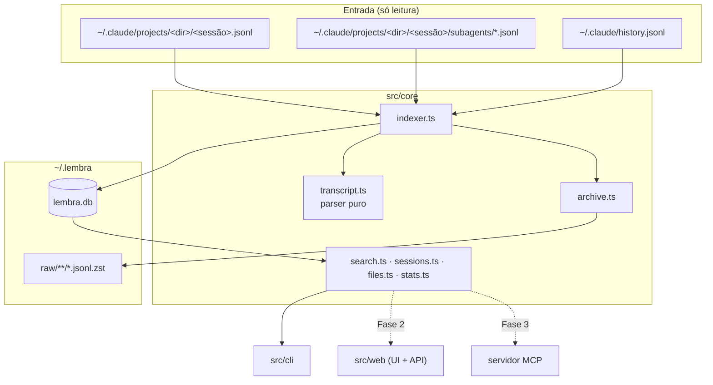

# Arquitetura

## Visão geral

`src/core` é a única camada que conhece o banco e os arquivos do Claude Code. As interfaces (a CLI hoje; a web e o MCP depois) consomem funções que devolvem dados.

## Indexação (`indexer.ts`)

1. `listSources` encontra os transcripts principais (`<dir>/<sessão>.jsonl`) e os de subagentes (`<dir>/<sessão>/subagents/*.jsonl`), ordenados do mais antigo para o mais novo. Assim, um Edit sempre encontra a versão escrita antes.
2. Para cada arquivo, a tabela `sources` guarda `offset` (o byte até onde já foi lido) e `size`. Se o tamanho não mudou, o arquivo é pulado. Se mudou, só os bytes novos são lidos. Uma linha incompleta no fim fica para a próxima execução.
3. Cada linha passa por `shouldParse`, que descarta registros de controle (`api-request-blob`, `permission-mode`…) olhando só o prefixo, sem `JSON.parse`. As demais vão para `parseRecord`.
4. O que sai do parser é gravado com `INSERT OR IGNORE`, usando chaves estáveis (`uid` de mensagem e de arquivo). Por isso reprocessar é idempotente.
5. Ao fim de cada arquivo, a sessão é atualizada: pasta, repo, branch, títulos, custo, primeiro e último prompt, contagem e intervalo de datas.
6. `importHistory` lê o `history.jsonl` e cria sessões `source = 'history'` apenas para ids que não têm transcript, nem no disco nem no banco. Entradas da última hora são ignoradas porque o transcript pode ainda não existir.
7. Com `archive: true` (`lembra index` e a primeira execução), cada arquivo alterado é copiado inteiro, comprimido com zstd, para `~/.lembra/raw/`, espelhando a estrutura de `~/.claude`.

`rereadIfParserChanged` compara `PARSER_VERSION` com a tabela `meta`. Quando o parser muda, zera os offsets e tudo é relido. As chaves únicas evitam duplicatas.

Todo comando de leitura da CLI chama `indexAll` antes de rodar (sem arquivar). O custo é um `stat` por arquivo mais os bytes novos.

## Repositório de cada pasta (`repo.ts`)

A pasta da sessão vira `owner/nome` pelo `git remote get-url origin`. Sem remote, usa o nome da raiz do git; sem git, o nome da pasta. Sufixos de worktree (`/.claude/worktrees/x`) são removidos antes. O resultado fica em cache na tabela `repos`.

## Cofre de arquivos

| Origem | `kind` | Conteúdo guardado |
|---|---|---|
| Write (`toolUseResult.type` = `create` ou `update`) | `write` | `content` completo |
| Edit | `edit` | `originalFile` com a troca aplicada. Sem `originalFile`, a última versão conhecida do caminho com a troca aplicada. Se a troca não se aplica, `sha` fica nulo |
| Read de arquivo inteiro fora da pasta da sessão | `read` | `file.content` |
| Caminho citado num prompt e existente no disco (até 10 MB) | `ref` | Cópia do arquivo no momento da indexação |
| Imagem colada no prompt | `image` | Bytes da imagem (caminho relativo `imagem-<uuid>-<n>.<ext>`) |

Os blobs são endereçados por SHA-256 e comprimidos com zstd (`blobs.ts`), então o mesmo conteúdo é guardado uma vez só.

## Busca (`search.ts`)

- `toMatchQuery` transforma cada palavra em `"palavra"*` (prefixo) e mantém `"frases entre aspas"` como frase exata. Aspas internas são escapadas, e a sintaxe do FTS5 nunca vaza.
- O tokenizer é `unicode61 remove_diacritics 2`: "relatorio" encontra "Relatório".
- O score é o `bm25` com pesos por papel: prompt ×2, resumo ×1,5, resposta ×1. Títulos (`sessions_fts`) entram com peso ×3.
- Os resultados são agrupados por sessão, com até dois trechos cada. Os termos encontrados chegam marcados com `\x01…\x02`, e cada interface decide como destacá-los.

## Schema (`db.ts`)

| Tabela | Papel |
|---|---|
| `meta` | `parser_version` |
| `sources` | Offset, tamanho lido e tamanho arquivado de cada arquivo de origem |
| `repos` | Cache de pasta → repositório |
| `sessions` | Uma linha por sessão (`source` = `transcript` ou `history`), com título derivado |
| `messages` + `messages_fts` | Prompts, respostas e resumos, com o índice FTS5 mantido por triggers |
| `sessions_fts` | Índice FTS5 dos títulos |
| `blobs` | Conteúdo por hash, comprimido com zstd |
| `files` | Cada operação de arquivo: caminho, tipo, sessão, data e o `sha` da versão resultante |

O banco usa WAL e `busy_timeout`, o que permite duas execuções simultâneas (por exemplo, um hook e um terminal). A pasta `~/.lembra` é criada com permissão `700`.

## Decisões

- **Bun sem dependências de runtime.** `bun:sqlite`, `Bun.zstdCompressSync`, `Bun.Glob` e `Bun.CryptoHasher` cobrem tudo, o que deixa a instalação trivial e o início rápido.
- **SQLite local em vez de serviço.** Os dados são sensíveis (tudo que já foi colado num prompt), então nada sai da máquina.
- **CLI primeiro.** O núcleo foi desenhado para a UI web e o MCP reaproveitarem as mesmas funções.
- **Banco descartável, origem preservada.** O índice pode ser apagado e reconstruído; o que não pode ser perdido (os transcripts) fica na cópia bruta.
