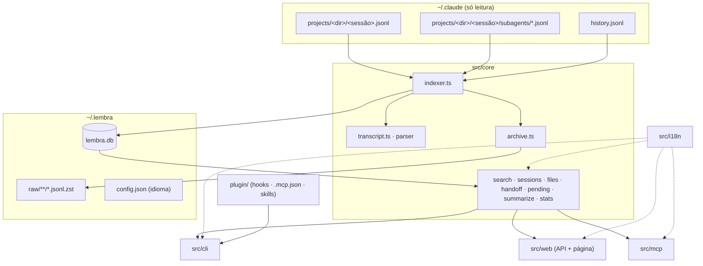

# Arquitetura

## Visão geral

`src/core` é a única camada que conhece o banco e os arquivos do Claude Code. As interfaces (CLI, página, MCP) consomem funções que devolvem dados ou lançam `LembraError` com código, e traduzem tudo com os catálogos de `src/i18n`.

## Indexação (`indexer.ts`)

1. `listSources` encontra os transcripts principais (`<dir>/<sessão>.jsonl`) e os de subagentes (`<dir>/<sessão>/subagents/*.jsonl`), do mais antigo para o mais novo. Assim, um Edit sempre encontra a versão escrita antes dele.
2. A tabela `sources` guarda `offset` (o último byte lido) e `size`. Arquivo com o mesmo tamanho é pulado. Se mudou, só os bytes novos são lidos, em blocos de 8 MB (`completeLines`). Uma linha maior que o bloco dobra o bloco; uma linha incompleta no fim fica para a próxima execução. O `size` só é gravado ao terminar, para que uma execução interrompida retome do offset.
3. `shouldParse` descarta registros de controle (`api-request-blob`, `permission-mode`…) pelo prefixo, sem `JSON.parse`. As demais linhas vão para `parseRecord`.
4. Tudo é gravado com `INSERT OR IGNORE` e chaves estáveis (`uid`), o que torna o reprocessamento idempotente. Quando `PARSER_VERSION` muda, `rereadIfParserChanged` zera os offsets e tudo é relido sem duplicar.
5. Ao fim de cada bloco, a sessão é atualizada: pasta, repo, branch, títulos, custo, primeiro e último prompt, contagem e intervalo de datas. O título só é regravado quando muda, porque cada gravação refaz a linha do FTS.
6. `importHistory` cria sessões `source = 'history'` para ids do `history.jsonl` sem transcript. O arquivo só cresce, então a leitura também é incremental: ela para na primeira entrada da última hora (o transcript pode ainda não existir) e a próxima execução retoma dali.
7. Sessões cuja pasta fica dentro de `~/.lembra`, como os resumos gerados pelo próprio `lembra`, são ignoradas.
8. Com `archive: true` (no `lembra index`, no hook e na primeira execução), cada arquivo alterado é copiado inteiro para `~/.lembra/raw/` via zstd em streaming: grava num `.partial` e renomeia no fim.

Quem chama a indexação: a CLI antes de cada leitura; a página (no máximo a cada 5 s por requisição, e em segundo plano a cada 60 s); o MCP antes de cada ferramenta; os hooks `SessionEnd` e `PreCompact`; e o `launchd` uma vez por dia.

## Repositório de cada pasta (`repo.ts`)

A pasta da sessão vira `owner/nome` pelo `git remote get-url origin`. Sem remote, usa o nome da raiz do git; sem git, o nome da pasta. Sufixos de worktree (`/.claude/worktrees/x`) são removidos antes, e o resultado fica em cache na tabela `repos`.

## Cofre de arquivos

| Origem | `kind` | Conteúdo guardado |
|---|---|---|
| Write (`toolUseResult.type` = `create` ou `update`) | `write` | `content` completo |
| Edit | `edit` | `originalFile` com a troca aplicada. Sem `originalFile`, a última versão conhecida do caminho com a troca aplicada. Se a troca não se aplica, `sha` fica nulo |
| Read de arquivo inteiro fora da pasta da sessão | `read` | `file.content` |
| Caminho citado num prompt e existente no disco (até 10 MB) | `ref` | Cópia do arquivo no momento da indexação |
| Imagem colada no prompt | `image` | Bytes da imagem |

Os blobs são endereçados por SHA-256 e comprimidos com zstd (`blobs.ts`).

## Busca (`search.ts`)

- `toMatchQuery` transforma cada palavra em `"palavra"*` (prefixo) e mantém `"frases"` como frase exata. Aspas são escapadas, então a sintaxe do FTS5 nunca vaza.
- O tokenizer é `unicode61 remove_diacritics 2`: "relatorio" encontra "Relatório".
- O score é o `bm25` com pesos por papel: prompt ×2; resumo do `/compact` e resumo do Haiku ×1,5; resposta ×1. Títulos (`sessions_fts`) entram com peso ×3.
- Os resultados vêm agrupados por sessão, com até dois trechos. Os termos encontrados chegam marcados com `\x01…\x02`, e cada interface decide como destacar.
- A busca roda em duas etapas: primeiro ranqueia sem `snippet()`, depois gera trechos só para as mensagens que vão aparecer. `snippet()` é a parte cara, e uma palavra comum casa com milhares de mensagens.

## Segredos (`secrets.ts`)

`redact` aplica uma lista de regras: tokens com prefixo conhecido (GitHub, GitLab, Slack, Stripe, OpenAI, Anthropic, Google, npm), chaves AWS, JWTs, blocos de chave privada, `Bearer …`, senhas em URLs (`postgres://user:senha@`), variáveis com nome de segredo (`DB_PASSWORD=…`) e chaves de configuração com valor entre aspas (`"accessToken": "…"`). Cada ocorrência vira `[REDACTED:tipo]`. Referências como `$VAR`, `process.env.X`, `${X}` e números curtos (`TOKEN_TTL=3600`) não são mascaradas.

- **Texto indexado:** prompts, respostas, resumos (inclusive a saída do Haiku) e títulos passam por `redact` antes de ir para o banco. Por isso nada mascarado aparece na busca, na página, no handoff, no MCP ou no que é enviado para os resumos.
- **Arquivos guardados:** ficam byte a byte, porque o restore precisa devolver o arquivo exato. A coluna `files.secrets` conta o que foi encontrado, a página mostra um selo, e a ferramenta MCP `get_file` devolve o conteúdo mascarado com um aviso. `lembra cat` e o download na página entregam o original a você.
- **Migração:** `REDACTION_VERSION` fica na tabela `meta`. Quando a versão muda, `redactStored` remascara todas as mensagens, títulos e resumos, recalcula os títulos derivados e reconta os segredos dos arquivos. Um trigger `AFTER UPDATE` mantém o FTS em dia.
- **A cópia bruta** em `raw/` espelha o `~/.claude` sem alteração (ela serve para devolver transcripts ao Claude Code), então continua contendo o que o próprio Claude Code já guarda em texto puro.

## Handoff, resumos e pendências

- **`handoff.ts`** monta um Markdown com pedido inicial, último resumo do `/compact`, últimos pedidos, última resposta e arquivos (com `lembra cat <id>`). É usado pela CLI, pela página e pela ferramenta MCP `handoff`.
- **`summarize.ts`** escolhe sessões terminadas há mais de 30 minutos, com pelo menos 2 prompts e sem resumo (ou que mudaram depois dele). O prompt pede o resumo no idioma do usuário, e o resultado vai para `sessions.digest` e para `messages` (papel `digest`), onde fica pesquisável. O `Runner` padrão chama `claude -p --model haiku --no-session-persistence` a partir de `~/.lembra/summaries`.
- **`pending.ts`** agrupa sessões recentes (14 dias por padrão, `DEFAULT_PENDING_SINCE`) por raiz git e branch (ignorando `main`, `master`, `develop`, a branch padrão do remote e `HEAD`) e consulta um `GitProbe`: se a branch existe, se tem upstream, quantos commits estão à frente e se há alterações quando ela está checada. O estado dos PRs vem de um `gh pr list` por repositório; só branches mais antigas que os 200 PRs mais recentes ganham uma consulta própria. PR mergeado ou aberto conta como entregue.
- **`exec.ts`** é o único jeito de rodar outro programa (git, gh, claude, launchctl, pbcopy, osascript), e `forEachLimited` limita quantos rodam ao mesmo tempo.

## Página (`src/web`)

- **`server.ts`** sobe o `Bun.serve` só em `127.0.0.1`. Ele serve a página (HTML import do Bun, que empacota TS, CSS e fontes), o `manifest.webmanifest`, os ícones e a API. A indexação roda em voo único: requisições simultâneas compartilham uma passada.
- **`api.ts`** expõe `search`, `sessions/:id` (com `handoff` e `terminal`), `messages/:id`, `files` (com `raw` e `restore`), `facets`, `stats`, `pending`, `index` e `health`.
- **Mensagens longas:** o detalhe da sessão manda no máximo 4.000 caracteres de cada mensagem, cortados no próprio SQL (`sessionMessages` com `maxChars`). A mensagem cortada leva `truncated: true`, e a página oferece o texto inteiro em `messages/:id`, como texto puro numa aba nova. Handoff, resumos, MCP e CLI usam o mesmo corte, cada um com seu limite.
- **Segurança:**
  - Recusa qualquer `Host` que não seja `localhost:porta` ou `127.0.0.1:porta`, o que barra DNS rebinding.
  - Escritas exigem o cabeçalho `x-lembra: 1` e origem própria. Como a API nunca libera CORS, outro site não consegue enviar esse cabeçalho.
  - Erros esperados voltam traduzidos; os inesperados só são logados no servidor.
- **Idioma:** cada requisição resolve o idioma por `?lang`, depois `Accept-Language`, depois o idioma escolhido no servidor.
- **`ui/`** é TypeScript sem framework: `lib/dom.ts` (`h()` só cria nós de texto, sem XSS), estado na URL (`lib/state.ts`), componentes em `components/<nome>/` e tokens em `styles/tokens.css`. Detalhes no [guia de UI](ui-guidelines.md).

## MCP (`src/mcp`)

Servidor stdio sem dependências: JSON-RPC 2.0, uma mensagem por linha. Implementa `initialize` (devolve a versão de protocolo pedida pelo cliente), `ping`, `tools/list` e `tools/call`, e ignora notificações. Erros de uso viram resultado com `isError: true`, para que o Claude possa corrigir a chamada. As descrições das ferramentas ficam em inglês; os resultados saem no idioma configurado. O índice é atualizado antes de cada chamada.

## Plugin e instalação

- **`plugin/`** tem o manifesto, `hooks/hooks.json` (`SessionEnd` e `PreCompact` → `lembra hook`, sempre com saída 0), `.mcp.json` (`lembra mcp`) e as skills `handoff` e `history`. A raiz do repositório é um marketplace (`.claude-plugin/marketplace.json`), e o plugin é instalado como `lembra@lembra`, lido direto de `plugin/`.
- **`src/system/install.ts`** executa os passos em ordem, cada um verificando antes de agir:
  1. link em `~/.local/bin`;
  2. `cleanupPeriodDays`, com backup do `settings.json`;
  3. registro do marketplace e instalação do plugin;
  4. dois LaunchAgents: `com.lembra.server` roda `ui --serve` no login e é reiniciado se cair; `com.lembra.index` roda `index` às 12:30.

  Um agente é recarregado se o plist mudou ou se o `launchd` não o tem carregado (`launchctl print`). O `bootstrap` é repetido enquanto o `launchd` libera a instância anterior. Os plists levam o `PATH` e o `LANG` do momento da instalação.

## Schema (`db.ts`)

| Tabela | Papel |
|---|---|
| `meta` | `parser_version` |
| `sources` | Offset, tamanho lido e tamanho arquivado de cada arquivo de origem |
| `repos` | Cache de pasta → repositório |
| `sessions` | Uma linha por sessão (`source` = `transcript` ou `history`), título derivado, `digest`/`digest_at` |
| `messages` + `messages_fts` | Prompts, respostas, resumos do `/compact` e do Haiku; FTS5 mantido por triggers |
| `sessions_fts` | FTS5 dos títulos |
| `blobs` | Conteúdo por hash, comprimido com zstd |
| `files` | Cada operação de arquivo: caminho, tipo, sessão, data e o `sha` da versão resultante |

O banco usa WAL e `busy_timeout`, o que permite processos simultâneos (hook, página, terminal). A pasta `~/.lembra` tem permissão `700`.

## Decisões

- **Bun sem dependências de runtime**, exceto as fontes da página. `bun:sqlite`, zstd, `Bun.Glob`, `Bun.serve` com HTML imports e `Bun.CryptoHasher` cobrem o resto.
- **Local primeiro.** Os dados são sensíveis (tudo que já foi colado num prompt), então nada sai da máquina; a única exceção são os resumos, que usam o `claude -p` do próprio usuário e só quando ele pede.
- **Um núcleo, várias interfaces.** CLI, página e MCP chamam as mesmas funções; nenhuma delas acessa SQL diretamente, exceto via `src/core`.
- **Banco descartável, origem preservada.** O índice pode ser apagado e reconstruído; o que não pode se perder (os transcripts) fica na cópia bruta.
- **Textos com tipo.** Catálogos de i18n tipados pelo inglês tornam impossível esquecer uma tradução sem quebrar a compilação.
